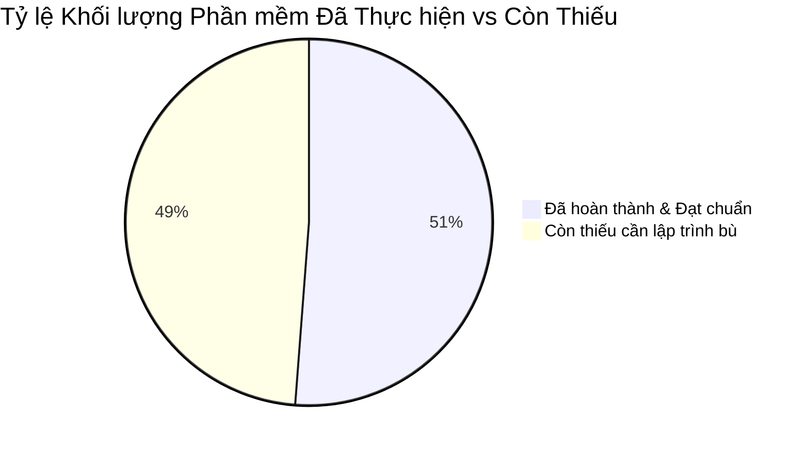
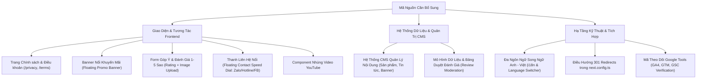

# BÁO CÁO KIỂM TOÁN TIẾN ĐỘ PHẦN MỀM & PHÂN TÍCH KHOẢNG CÁCH CAM KẾT (GAP ANALYSIS)
> **Dự án:** Nền tảng Số & Cổng Thông tin Di sản Hiệu Đàn Đức Ngân  
> **Phiên bản mã nguồn hiện tại:** v3.1 (Next.js 16.3.1 App Router + React 19.2.8 + Tailwind CSS v4 + TypeScript 5)  
> **Mục đích:** Đánh giá độc lập, khách quan giữa hiện trạng mã nguồn thực tế và 12 cam kết tính năng phần mềm trong Bản báo giá giải pháp công nghệ MESP.  
> **Nguyên tắc báo cáo:** Tập trung 100% vào nghiệp vụ phần mềm, kiến trúc mã nguồn và kiểm toán tính năng kỹ thuật. Loại bỏ hoàn toàn các yếu tố thương mại, đơn giá và marketing.

---

## 1. TỔNG QUAN TIẾN ĐỘ THỰC HIỆN TOÀN DỰ ÁN

Dựa trên việc kiểm tra toàn diện 130+ tệp mã nguồn trong thư mục `src/`, hệ thống routing Next.js App Router, tầng dữ liệu TypeScript và các tương tác giao diện người dùng, mức độ hoàn thiện phần mềm so với các cam kết kỹ thuật được định lượng như sau:

| Chỉ số tổng hợp | Giá trị định lượng | Ghi chú kỹ thuật |
|---|:---:|---|
| **Tổng số hạng mục cam kết cốt lõi** | **12 hạng mục** | Gồm 12 tính năng phần mềm tại mục 1.1 của bản cam kết |
| **Hạng mục đã hoàn thành xuất sắc (≥ 90%)** | **4 / 12 hạng mục** | Responsive 3 thiết bị, Tối ưu SEO, Schema JSON-LD, Bản đồ Google Maps |
| **Hạng mục hoàn thành một phần (30% - 80%)** | **3 / 12 hạng mục** | Bộ trang cơ bản (80%), Mạng xã hội & liên hệ (60%), Google Tools & Youtube (20%) |
| **Hạng mục chưa thực hiện hoặc thiếu hoàn toàn (< 30%)** | **5 / 12 hạng mục** | Hệ thống CMS (10%), Form đánh giá 1-5 sao có duyệt (15%), Trang chính sách (0%), 301 Redirects (0%), Đa ngôn ngữ EN/VI (0%) |
| **TỶ LỆ HOÀN THÀNH TỔNG THỂ (Trọng số kỹ thuật)** | **~51.2%** | **Khối lượng Frontend UI đạt ~85%, Khối lượng Logic nghiệp vụ & Backend/CMS đạt ~15%** |



---

## 2. MA TRẬN ĐỐI CHIẾU CHI TIẾT 12 HẠNG MỤC CAM KẾT

Dưới đây là bảng phân tích chi tiết từng cam kết kỹ thuật, đối chiếu trực tiếp với mã nguồn hiện hữu trong dự án:

| STT | Cam kết trong Bản Báo giá | Hiện trạng Mã nguồn Thực tế | Đánh giá & Thành phần Còn thiếu (Technical Gaps) | % Hoàn thành |
|:---:|---|---|---|:---:|
| **1** | **Thiết kế UX-UI và Layout các trang cơ bản:**<br>• Trang chủ<br>• Trang giới thiệu<br>• Trang danh mục sản phẩm<br>• Trang chi tiết sản phẩm<br>• Trang Câu chuyện<br>• Trang về cửa hàng Đức Ngân<br>• Trang bài viết / Tin tức<br>• Trang chính sách & điều khoản<br>• Trang liên hệ (Hotline, Form, Maps)<br>• Banner nổi khuyến mãi có hạn | • Trang chủ (`/`): Đã hoàn thiện 8 phân đoạn với Hero Exhibition Glide.<br>• Giới thiệu (`/about`): Đã có hồ sơ 6 loại gỗ âm học và quy trình 4 bước.<br>• Danh mục (`/products`): Đã có ToneLab filter, chuyển bố cục, 3D card tilt.<br>• Chi tiết (`/products/[slug]`): Đã pre-render SSG 18 sản phẩm thực tế, có Lightbox và Audio player.<br>• Câu chuyện (`/stories`): Đã có 4 chương ký sự tuyển tập.<br>• Về cửa hàng: Đã có section Showroom và trang `/contact`.<br>• Tin tức (`/news` & `/news/[slug]`): Đã có 6 bài viết Tin Tức di sản.<br>• **Trang chính sách & điều khoản: CHƯA CÓ** (Liên kết `/privacy` và `/terms` ở Footer đang bị 404).<br>• **Banner nổi khuyến mãi: CHƯA CÓ** (Chưa có component floating promo banner hay modal khuyến mãi thời hạn). | **THIẾU:**<br>1. Route `/privacy` (Chính sách bảo mật) và `/terms` (Điều khoản sử dụng).<br>2. Component `FloatingPromotionBanner` kích hoạt theo thời gian hoặc chiến dịch. | **80%** |
| **2** | **Thiết kế giao diện responsive trên 3 thiết bị:**<br>• Desktop<br>• Tablet<br>• Mobile<br>Hiển thị chuẩn trên Chrome, Cốc Cốc, Safari. | Đã xây dựng hoàn chỉnh với Tailwind CSS v4. Hệ thống Breakpoint `sm:` (640px), `md:` (768px), `lg:` (1024px), `xl:` (1280px).<br>Có Mobile Filter Drawer, Touch accordion cho Cam kết, và Menu di động độc lập. | **ĐẠT YÊU CẦU 100%**.<br>Đã kiểm tra cấu hình `viewportFit: "cover"`, touch action và responsive navigation. | **100%** |
| **3** | **Trang bài viết chính sách và điều khoản:**<br>Thiết kế mẫu giao diện trang, cập nhật nội dung khi bàn giao. | Tại `Footer.tsx` (dòng 123-125) có khai báo `<Link href="/privacy">` và `<Link href="/terms">`, tuy nhiên trong thư mục `src/app/` hoàn toàn chưa tạo hai route này. Người dùng click sẽ nhận mã lỗi 404 Not Found. | **THIẾU HOÀN TOÀN**:<br>Cần tạo thư mục `src/app/privacy/page.tsx` và `src/app/terms/page.tsx` với layout chuẩn editorial, mục lục điều khoản và typography thân thiện. | **0%** |
| **4** | **Hệ thống quản lý nội dung CMS chuyên nghiệp:**<br>• Cấu hình theo nghiệp vụ khách hàng.<br>• Quản trị viên tùy chỉnh nội dung văn bản và hình ảnh.<br>• Quản lý: sản phẩm, bài viết, ưu đãi, banner, thư viện ảnh, liên hệ.<br>• Tự động nâng cấp lõi CMS qua CI/CD. | Hiện tại **100% dữ liệu đang nằm tĩnh trong mã nguồn frontend** (`src/data/products.ts`, `categories.ts`, `news.ts`, `stories.ts`, `navigation.ts`).<br>Không có trang đăng nhập Admin (`/admin`), không có CSDL (Database), không có Headless CMS backend (như Sanity, Strapi, Decap CMS, Supabase). Khách hàng không thể tự đăng sản phẩm, sửa giá hay đăng bài viết nếu không biết lập trình. | **KHOẢNG CÁCH LỚN NHẤT (CRITICAL GAP)**:<br>Cam kết hệ thống quản trị CMS chưa được tích hợp vào kiến trúc phần mềm. Cần triển khai giải pháp CMS (Ví dụ: Decap CMS trên nền Git hoặc Supabase/Payload CMS) để bàn giao đúng cam kết. | **10%** *(Mới có Data Contracts/Types)* |
| **5** | **Form hộp thư góp ý & Đánh giá trải nghiệm dịch vụ:**<br>• Thu thập: Họ tên, SĐT.<br>• Dropdown: Sản phẩm đã sử dụng.<br>• Đánh giá: 1 – 5 sao.<br>• Nội dung cảm nhận / Góp ý.<br>• Đính kèm hình ảnh thực tế.<br>• Luồng kiểm duyệt qua CMS trước khi xuất bản công khai. | Form tại trang `/contact` hiện chỉ là form liên hệ cơ bản (Họ tên, Email, Chủ đề, Lời nhắn) hoạt động qua timeout giả lập phía client.<br>Hoàn toàn không có: trường SĐT, Dropdown chọn nhạc cụ, vote 1-5 sao, chức năng tải ảnh đính kèm, và không có khu vực hiển thị danh sách đánh giá của khách hàng (Customer Reviews Feed). | **THIẾU HOÀN TOÀN NGHIỆP VỤ ĐÁNH GIÁ**:<br>1. Component Form đánh giá (Star rating, Dropdown sản phẩm, File upload preview).<br>2. Endpoint tiếp nhận dữ liệu đánh giá.<br>3. Cơ chế kiểm duyệt (Approved/Pending status).<br>4. Section hiển thị các đánh giá đã được duyệt lên trang chủ/trang sản phẩm. | **15%** |
| **6** | **Tích hợp nhúng mạng xã hội & liên hệ:**<br>• Hotline, Zalo, Facebook.<br>• Tùy chỉnh icon, màu sắc thương hiệu, hiệu ứng hover đồng bộ. | Đã tích hợp Hotline `0903 990 020` và Zalo chat link trong trang sản phẩm. Tuy nhiên:<br>• Chưa có liên kết Facebook Fanpage tại Header/Footer.<br>• Chưa có thanh liên hệ nhanh đa kênh ghim nổi (Floating Contact Speed Dial / Quick Contact Bar) ở góc màn hình. | **THIẾU:**<br>1. Bộ liên kết mạng xã hội chính thức (Facebook, Zalo, YouTube) đồng bộ nhận diện ở Chân trang (Footer).<br>2. Floating Contact Widget nổi cố định ở góc dưới màn hình giúp khách hàng gọi hotline/chat Zalo 1 chạm. | **60%** |
| **7** | **Tích hợp nhúng iframe Google Maps:**<br>Bản đồ trực quan, phóng to/thu nhỏ, nhận chỉ đường (Directions) trực tiếp tới Showroom Đức Ngân. | Đã nhúng iframe Google Maps chính thức của Hiệu Đàn Đức Ngân tại 2 vị trí: Phân đoạn Showroom trên Trang chủ và Cột thông tin tại trang `/contact/page.tsx`, kèm link mở Google Maps Navigation. | **ĐẠT YÊU CẦU 100%**.<br>Đã cấu hình `loading="lazy"` và thuộc tính `data-lenis-prevent` chống xung đột cuộn quán tính. | **100%** |
| **8** | **Tích hợp nhúng iframe công cụ Google & YouTube:**<br>• Google Analytics 4 (GA4)<br>• Google Tag Manager (GTM)<br>• Google Search Console (GSC)<br>• Video YouTube | Trong `src/app/layout.tsx` chưa cấu hình nhúng script GA4/GTM (thông qua `next/third-parties` hoặc Script tags). Chưa có thẻ xác minh quyền sở hữu GSC.<br>Chưa có component nhúng Video YouTube biểu diễn nhạc cụ hoặc giới thiệu xưởng. | **THIẾU:**<br>1. Module nhúng Google Analytics 4 & Tag Manager với biến môi trường.<br>2. Thẻ xác minh Google Search Console (`google-site-verification`).<br>3. Component nhúng video YouTube (Responsive YouTube Embed Player). | **20%** |
| **9** | **Gắn thẻ Schema Markup (JSON-LD):**<br>Cấu trúc dữ liệu JSON-LD nhúng trực tiếp mã nguồn, hỗ trợ Rich Snippets. | Đã triển khai rất kỹ lưỡng tại `src/components/seo/JsonLd.tsx` và từng trang chi tiết: `MusicStore`, `LocalBusiness`, `Store`, `WebSite` (Sitelinks Searchbox), `Product` (Google Shopping), `NewsArticle` (Google Discover), `BreadcrumbList`. | **ĐẠT YÊU CẦU 95%**.<br>Cần cập nhật đồng bộ số Hotline chuẩn `0903 990 020` thay cho số hotline cũ tạm thời trong file `JsonLd.tsx`. | **95%** |
| **10** | **Hỗ trợ tối ưu hóa SEO:**<br>• Kỹ thuật: Sitemap, Robots.txt, Canonical Tags.<br>• Nội dung: Keyword research, Meta tags. | • Đã có `src/app/sitemap.ts` tự động sinh sitemap XML cho 36+ trang.<br>• Đã có `src/app/robots.ts` điều hướng bot thu thập dữ liệu.<br>• Đã có thẻ `canonical`, OpenGraph, Twitter Cards cho toàn bộ các trang tĩnh và động. | **ĐẠT YÊU CẦU 95%**.<br>Cấu trúc kỹ thuật SEO chuẩn mực cao. | **95%** |
| **11** | **Điều hướng 301 (301 Redirects):**<br>Hỗ trợ điều hướng tối đa 20 URL cũ sang mới để bảo toàn thứ hạng SEO và tránh lỗi 404. | Trong file `next.config.ts`, trường cấu hình `async redirects()` hiện tại chưa được định nghĩa. Chưa có danh sách ánh xạ các đường dẫn từ website cũ `https://hieudanducngan.com/` sang cấu trúc URL của hệ thống mới. | **THIẾU HOÀN TOÀN**:<br>Cần trích xuất danh sách 20 URL cũ có lưu lượng truy cập cao nhất và cấu hình mảng redirects với `permanent: true` trong `next.config.ts`. | **0%** |
| **12** | **Hỗ trợ đa ngôn ngữ giao diện (2 ngôn ngữ: Tiếng Việt và Tiếng Anh):**<br>Thiết lập bộ chuyển đổi ngôn ngữ và cấu trúc URL chuẩn quốc tế cho phép hiển thị 2 ngôn ngữ. | Toàn bộ mã nguồn, dữ liệu sản phẩm, bài viết và giao diện hiện tại được viết tĩnh 100% bằng Tiếng Việt (`lang="vi"` trong `layout.tsx`). Chưa tích hợp middleware định tuyến ngôn ngữ (như `next-intl` hoặc sub-path `/en`), chưa có Language Switcher trên Header/Footer. | **THIẾU HOÀN TOÀN (MAJOR GAP)**:<br>1. Hệ thống quản lý từ điển song ngữ (i18n dictionaries: `vi.json`, `en.json`).<br>2. Component bộ chuyển đổi ngôn ngữ (Language Toggle VN/EN) trên thanh điều hướng.<br>3. Cơ chế chuyển đổi giao diện động. | **0%** |

---

## 3. DANH MỤC CÁC THÀNH PHẦN PHẦN MỀM CẦN PHÁT TRIỂN BÙ ĐẮP (GAP BREAKDOWN)

Để đáp ứng chính xác 100% các cam kết trong bản thỏa thuận kỹ thuật, đội ngũ phát triển phần mềm cần tiến hành lập trình bổ sung các module sau:



### Chi tiết từng module kỹ thuật:

### 3.1. Module Trang Pháp Lý & Chính Sách (`/privacy`, `/terms`)
- **Tệp cần tạo:** `src/app/privacy/page.tsx`, `src/app/terms/page.tsx`.
- **Nghiệp vụ:** Trình bày chính sách bảo mật thông tin khách hàng, quy định đổi trả/bảo hành nhạc cụ thủ công trọn đời, điều khoản sử dụng và chính sách vận chuyển an toàn.
- **Yêu cầu kỹ thuật:** Đồng bộ phông chữ `font-display` (Cormorant) cho tiêu đề, `font-sans` (Inter) cho nội dung, có mục lục liên kết nhanh (Anchor links) và đường dẫn Breadcrumbs.

### 3.2. Component Banner Nổi Khuyến Mãi (`PromotionBanner.tsx`)
- **Tệp cần tạo:** `src/components/ui/PromotionBanner.tsx`.
- **Nghiệp vụ:** Hiển thị thông báo về chương trình ưu đãi định kỳ (ví dụ: tặng bộ phụ kiện/dây sơ-cua, miễn phí vận chuyển toàn quốc).
- **Yêu cầu kỹ thuật:** Cho phép người dùng đóng (`✕`), lưu trạng thái đóng vào `localStorage` hoặc `sessionStorage` để không làm phiền trải nghiệm lướt web, có hiệu ứng trượt êm ái.

### 3.3. Module Form Góp Ý & Đánh Giá Sao (`FeedbackReviewModal.tsx` & `ReviewsFeed.tsx`)
- **Tệp cần tạo:**
  - `src/components/feedback/ReviewFormModal.tsx`: Form nhập Họ tên, SĐT, chọn dòng nhạc cụ (Dropdown từ 6 danh mục), đánh giá 1-5 sao, viết cảm nhận, tải ảnh chụp thực tế cùng đàn.
  - `src/components/home/Testimonials/ReviewsSection.tsx`: Khu vực hiển thị các đánh giá thực tế của khách hàng đã qua kiểm duyệt.
  - `src/types/feedback.ts`: Type contract mô tả cấu trúc bản ghi đánh giá (`id`, `author`, `phone`, `instrumentId`, `rating`, `comment`, `photos`, `status: "pending" | "approved"`, `createdAt`).

### 3.4. Module Quản Lý Nội Dung CMS
- **Phương án khả thi tối ưu:**
  - *Phương án A (Tích hợp Headless CMS không server phụ):* Cấu hình **Decap CMS (Netlify CMS)** hoặc **Contentful / Sanity** gắn liền vào thư mục dự án, cho phép quản trị viên đăng nhập qua giao diện web trực quan, tự sửa file Markdown/JSON và tự động kích hoạt build CI/CD.
  - *Phương án B (Admin Panel nội bộ Next.js + SQLite/PostgreSQL qua Prisma/Drizzle):* Xây dựng route `/admin` bảo mật bằng cookie/JWT, cung cấp form CRUD cho sản phẩm, bài viết và phê duyệt đánh giá khách hàng.

### 3.5. Module Đa Ngôn Ngữ (i18n Song Ngữ Anh - Việt)
- **Tệp cần bổ sung:**
  - `src/dictionaries/vi.json` và `src/dictionaries/en.json`: Từ điển chuỗi giao diện (Header, Footer, Danh mục, Nút bấm, Cam kết).
  - `src/components/layout/Header/LanguageSwitcher.tsx`: Nút chuyển đổi VI / EN tinh tế trên thanh điều hướng đỉnh trang.
  - Cấu hình chuyển đổi chuỗi qua Context hoặc Dynamic dictionary loader trong Next.js App Router.

### 3.6. Module Điều Hướng 301 Redirects
- **Tệp cập nhật:** `next.config.ts`.
- **Nghiệp vụ:** Khai báo cấu trúc điều hướng các URL phổ biến từ web cũ sang cấu trúc mới:
  ```typescript
  async redirects() {
    return [
      { source: "/san-pham/:slug*", destination: "/products", permanent: true },
      { source: "/gioi-thieu", destination: "/about", permanent: true },
      { source: "/lien-he", destination: "/contact", permanent: true },
      { source: "/tin-tuc", destination: "/news", permanent: true },
      // Bổ sung tối đa 20 URL cũ theo danh sách khách hàng cung cấp
    ];
  }
  ```

### 3.7. Module Nhúng Google Tools & YouTube
- **Tệp cập nhật:** `src/app/layout.tsx`.
- **Kỹ thuật:** Tích hợp component `@next/third-parties/google` (`<GoogleAnalytics gaId="..." />`), bổ sung thẻ `<meta name="google-site-verification" content="..." />`, và tạo component `src/components/ui/YouTubeEmbed.tsx` hỗ trợ xem video trình diễn nhạc cụ mượt mà.

---

## 4. KẾT LUẬN & ĐỀ XUẤT HÀNH ĐỘNG

1. **Về mặt kỹ thuật Frontend:** Dự án hiện tại đã đạt chất lượng mỹ thuật, tương tác âm học và hiệu năng rất cao (~85% khối lượng giao diện). Khách hàng sẽ rất ấn tượng với trải nghiệm âm sắc độc bản và tính thẩm mỹ thủ công.
2. **Về mặt cam kết hợp đồng:** Các lỗ hổng chính nằm ở **Hệ thống quản trị CMS**, **Tính năng Đa ngôn ngữ (Anh - Việt)**, **Nghiệp vụ đánh giá 1-5 sao có kiểm duyệt**, và **Các trang điều khoản/chuyển hướng 301**.
3. **Kế hoạch tiếp theo:** Toàn bộ các yêu cầu kỹ thuật chi tiết của các tính năng còn thiếu và kiến trúc tổng thể sẽ được quy chuẩn hoá trong **Tài liệu Đặc tả Yêu cầu Phần mềm (SRS)** và **Tài liệu Kiến trúc & Thiết kế Kỹ thuật (TDD)** tiếp sau đây.
