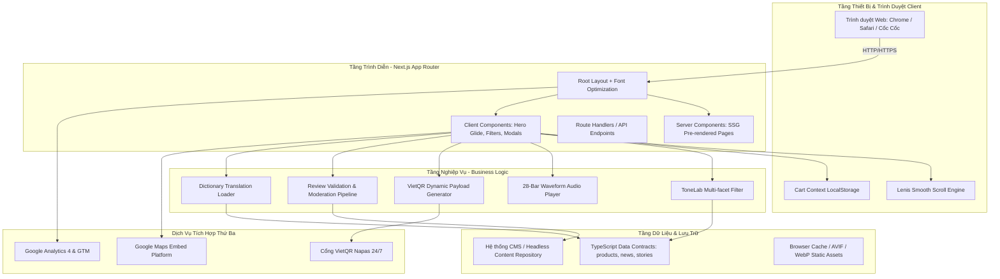

# TÀI LIỆU KIẾN TRÚC & THIẾT KẾ KỸ THUẬT PHẦN MỀM (TECHNICAL DESIGN DOCUMENT — TDD)
> **Hệ thống:** Cổng Thông tin & Thương mại Di sản Hiệu Đàn Đức Ngân  
> **Kiến trúc:** Next.js 16.3.1 App Router + React 19.2.8 + Tailwind CSS v4 + TypeScript 5  
> **Mục tiêu kỹ thuật:** Thiết lập kiến trúc phần mềm chuẩn mực, hiệu năng cao, phân tách ranh giới rõ ràng giữa Giao diện (Presentation), Nghiệp vụ (Domain), và Dữ liệu (Data).

---

## 1. TỔNG QUAN KIẾN TRÚC HỆ THỐNG (SYSTEM ARCHITECTURE)

Hệ thống được xây dựng theo mô hình **Kiến trúc Phân tầng Hiện đại (Modern Layered Architecture)** trên nền tảng Next.js App Router, khai thác tối đa sức mạnh của **React Server Components (RSC)** và **Client Component Boundaries**:



---

## 2. CẤU TRÚC THƯ MỤC & RANH GIỚI THÀNH PHẦN (DIRECTORY STRUCTURE)

Dự án tuân thủ triệt để nguyên tắc phân tách trách nhiệm (Separation of Concerns):

```
c:\dev\Hieu\duc-ngan-music\
├── public/                     # Tài nguyên tĩnh: ảnh sản phẩm cutout, texture gỗ, logo
├── src/
│   ├── app/                    # Routing theo quy chuẩn App Router
│   │   ├── layout.tsx          # Root Layout: Fonts, SmoothScrollProvider, CartProvider, SEO JsonLd
│   │   ├── page.tsx            # Trang chủ (Homepage) tích hợp 8 phân đoạn
│   │   ├── about/page.tsx      # Trang Giới thiệu di sản 25+ năm & 6 loại gỗ âm học
│   │   ├── products/           # Danh mục sản phẩm ToneLab & trang chi tiết
│   │   │   ├── page.tsx        # Danh sách sản phẩm với bộ lọc đa chiều
│   │   │   └── [slug]/page.tsx # Hồ sơ sản phẩm SSG tiền biên dịch
│   │   ├── stories/page.tsx    # Tuyển tập 4 chương ký sự chuyện nghề
│   │   ├── news/               # Tin Tức văn hóa & tin tức tạp chí
│   │   ├── contact/page.tsx    # Trang liên hệ, Showroom & Google Maps
│   │   ├── cart/page.tsx       # Giỏ hàng & thanh toán VietQR Napas
│   │   ├── privacy/page.tsx    # [Cần bổ sung] Chính sách bảo mật & bảo hành
│   │   ├── terms/page.tsx      # [Cần bổ sung] Điều khoản sử dụng dịch vụ
│   │   ├── sitemap.ts          # Bộ sinh sitemap.xml động
│   │   └── robots.ts           # Cấu hình robot thu thập dữ liệu
│   │
│   ├── components/             # Thư viện UI Components tái sử dụng
│   │   ├── home/               # Components chuyên biệt cho trang chủ
│   │   │   ├── InstrumentHero/ # Hero Carousel & Physical In-Place Detail Glide
│   │   │   ├── Categories/     # Phân loại 6 dòng nhạc cụ chính
│   │   │   ├── FeaturedProducts/# Kệ sản phẩm tiêu biểu nghệ nhân
│   │   │   ├── BrandStory/     # Ký ức chuyện nghề
│   │   │   ├── NewsSection/    # Điểm tin Tin Tức
│   │   │   ├── TrustSection/   # 5 cam kết âm học mộc bản
│   │   │   └── Showroom/       # Bản đồ và thông tin 526 Điện Biên Phủ
│   │   ├── catalogue/          # Bộ công cụ ToneLab lọc sản phẩm
│   │   ├── products/           # Dossier, Lightbox, Dải nghe âm sắc
│   │   ├── layout/             # Header sticky ghim đỉnh, Mega-menu, Footer
│   │   ├── cart/               # CartDrawer trượt, form thanh toán
│   │   ├── feedback/           # [Cần bổ sung] Form đánh giá sao & upload ảnh
│   │   ├── ui/                 # Atomic UI: ModalBase, Portal, CornerOrnament, Dividers
│   │   ├── seo/                # JsonLd structured data schemas
│   │   └── providers/          # SmoothScroll (Lenis), PageTransitionProvider
│   │
│   ├── context/                # React Context: CartContext (quản lý giỏ hàng)
│   ├── data/                   # Tầng dữ liệu tĩnh (Mock Data & Content)
│   ├── lib/                    # Thư viện tiện ích (utils, search, formatters)
│   └── types/                  # Type contracts TypeScript toàn dự án
```

---

## 3. MÔ HÌNH DỮ LIỆU & TYPE CONTRACTS (DATA MODELS)

Hệ thống quản lý dữ liệu chặt chẽ thông qua các hợp đồng dữ liệu TypeScript trong `src/types/index.ts`:

### 3.1. Hợp đồng dữ liệu Nhạc cụ (Product & Instrument)
```typescript
export interface Product {
  id: string;
  slug: string;
  name: string;
  category: string;
  categoryName: string;
  subtitle: string;
  price: number;
  originalPrice?: number;
  thumbnail: string;
  gallery: string[];
  description: string;
  story?: string;
  woodType: string;
  artisan: string;
  status: "available" | "made_to_order" | "sold_out";
  badge?: "Tuyển chọn" | "Thủ công" | "Sẵn hàng";
  specifications: {
    soundboardWood: string;   // Gỗ mặt đàn (Ngô đồng)
    bodyWood: string;         // Gỗ thân thùng đàn (Cẩm lai, Mun hoa, Trắc)
    frets: string;            // Phím cần đàn
    strings: string;          // Dây đàn
    dimensions?: string;      // Kích thước dài x rộng x cao
    weight?: string;          // Trọng lượng
    accessories: string[];    // Phụ kiện kèm theo (Bao da, móng gảy, dây sơ cua)
  };
  audioSample?: {
    title: string;
    artist: string;
    url: string;
    duration: string;
  };
  featured?: boolean;
}
```

### 3.2. Hợp đồng Đánh giá & Hộp thư góp ý (Customer Review Model)
```typescript
export interface CustomerReview {
  id: string;
  authorName: string;
  phoneNumber: string;       // Ẩn 4 số giữa khi hiển thị công khai (0903***020)
  productId?: string;        // ID nhạc cụ đã mua
  productName?: string;      // Tên hiển thị của nhạc cụ
  rating: number;            // Giá trị từ 1 đến 5 sao
  comment: string;           // Nội dung cảm nhận thực tế
  photos?: string[];         // Mảng URL ảnh đính kèm từ khách hàng
  status: "pending" | "approved" | "rejected"; // Luồng kiểm duyệt
  createdAt: string;         // ISO timestamp
  artisanResponse?: string;  // Phản hồi chính thức từ xưởng Đức Ngân
}
```

### 3.3. Hợp đồng Đơn hàng & Thanh toán (Order Model)
```typescript
export interface Order {
  orderCode: string;         // Ví dụ: DN-9X8K2M
  customer: {
    name: string;
    phone: string;
    email: string;
    address: string;
    city: string;
    note?: string;
  };
  items: {
    productId: string;
    productName: string;
    price: number;
    quantity: number;
    thumbnail: string;
  }[];
  subtotal: number;
  shippingCost: number;
  totalAmount: number;
  paymentMethod: "cod" | "vietqr" | "card";
  paymentStatus: "unpaid" | "paid" | "refunded";
  orderStatus: "new" | "voicing" | "shipping" | "completed";
  createdAt: string;
}
```

---

## 4. CƠ CHẾ CHUYỂN ĐỘNG & QUẢN LÝ CUỘN NỀN (INTERACTION & SMOOTH SCROLL)

### 4.1. Chuyển động vật lý đơn nhất (Physical In-Place Glide)
Trang chủ áp dụng giải pháp tương tác độc bản:
1. Khi click mở chi tiết nhạc cụ, component `InstrumentHero` giữ nguyên phần tử ảnh trong DOM, áp dụng biến đổi hình học:
   ```css
   transform: translateX(-22vw) scale(0.95);
   transition: transform 700ms cubic-bezier(0.22, 1, 0.36, 1);
   ```
2. Viewport được dịch chuyển tức thì lên tọa độ `(0, 0)` bằng lệnh:
   ```typescript
   window.scrollTo({ top: 0, behavior: "instant" });
   ```
3. Nút đóng `✕` được ghim ở vị trí tuyệt đối góc trên màn hình (`fixed top-6 right-10 z-[80]`), đảm bảo không bao giờ bị trôi khỏi tầm mắt.

### 4.2. Khóa cuộn nền thông minh (Lenis Scroll Lock with MutationObserver)
Để khắc phục xung đột giữa thư viện cuộn mượt `lenis` và các modal hiển thị toàn màn hình, hệ thống triển khai `SmoothScrollProvider`:
- Theo dõi thuộc tính `document.body.style.overflow` thông qua `MutationObserver`.
- Khi phát hiện `overflow: hidden` do modal/drawer kích hoạt: tự động gọi `lenis.stop()`.
- Khi đóng modal: tự động gọi `lenis.start()` phục hồi cuộn mượt.
- Các vùng tử nội bộ cần cuộn độc lập (như iframe Google Maps, danh sách giỏ hàng) được gán thuộc tính `data-lenis-prevent`.

---

## 5. PHÂN TÍCH VÀ ĐỀ XUẤT GIẢI PHÁP KIẾN TRÚC CMS (CMS ARCHITECTURE OPTIONS)

Để đáp ứng cam kết **"Hệ thống quản lý nội dung CMS chuyên nghiệp"** mà không phá vỡ tính ổn định của mã nguồn hiện tại, dưới đây là so sánh 3 phương án kiến trúc:

| Tiêu chí | Phương án 1: Git-based Headless CMS (Decap CMS) | Phương án 2: Embedded Next.js Admin + SQLite/Prisma | Phương án 3: Cloud Headless CMS (Sanity / Supabase) |
|---|---|---|---|
| **Cơ chế hoạt động** | Giao diện web tĩnh đọc/ghi file Markdown & JSON trực tiếp vào Git repo. | Xây dựng route `/admin` nội bộ với backend API Route và CSDL SQLite/Postgres. | Tách biệt hoàn toàn tầng dữ liệu lên cloud CMS, gọi qua REST/GraphQL API. |
| **Chi phí hạ tầng** | **0 VNĐ** (Chạy trực tiếp trên Hosting hiện hữu). | Cần môi trường máy chủ hỗ trợ Node.js server có ổ cứng ghi (Stateful). | Miễn phí ở mức cơ bản, phát sinh phí nếu vượt quota. |
| **Độ trễ tải trang** | Tải trang tức thì (100% SSG tiền biên dịch). | Rất nhanh (Kết hợp SSG + ISR on-demand). | Phụ thuộc tốc độ mạng gọi API đến máy chủ cloud CMS. |
| **Quy trình cập nhật** | Sửa nội dung $\to$ Tự động commit Git $\to$ Kích hoạt CI/CD build lại. | Sửa nội dung $\to$ Cập nhật DB tức thì $\to$ Tái xác thực trang (Revalidation). | Sửa nội dung $\to$ Kích hoạt Webhook revalidate. |
| **Phê duyệt đánh giá** | Phù hợp bài viết, sản phẩm; xử lý đánh giá realtime phức tạp hơn. | **Cực kỳ phù hợp cho luồng duyệt đánh giá (Pending $\to$ Approved)**. | Rất tốt. |
| **Mức độ phức tạp** | Thấp (chỉ cần file cấu hình `config.yml`). | Trung bình. | Trung bình. |

> **KHUYẾN NGHỊ KIẾN TRÚC (ARCHITECTURAL RECOMMENDATION):**  
> • **Giai đoạn trước mắt:** Tích hợp **Decap CMS** hoặc **Embedded Next.js Admin API** để quản trị viên có thể quản lý sản phẩm, bài viết và banner ngay trên giao diện web.  
> • Đối với tính năng **Đánh giá 1-5 sao có kiểm duyệt (STT 5)**: Triển khai một Route Handler nhẹ `/api/reviews` kết hợp bộ nhớ lưu trữ file JSON hoặc cơ sở dữ liệu SQLite siêu nhẹ để xử lý trạng thái `pending`/`approved` tức thì mà không cần cài đặt hạ tầng server phức tạp.
