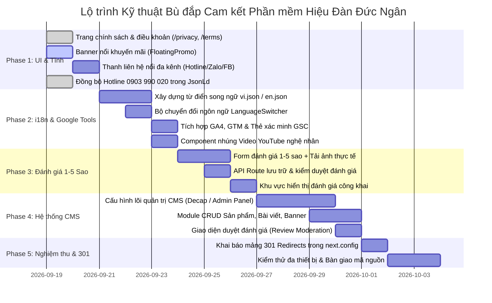

# LỘ TRÌNH KỸ THUẬT & KẾ HOẠCH THỰC THI BÙ ĐẮP CAM KẾT PHẦN MỀM (TECHNICAL ROADMAP)
> **Mục tiêu:** Định hướng các bước kỹ thuật cụ thể nhằm đưa tỷ lệ hoàn thành phần mềm từ **51.2%** lên **100% cam kết kỹ thuật** theo bản báo giá giải pháp công nghệ MESP.  
> **Nguyên tắc triển khai:** Thực hiện theo từng phân kỳ độc lập, kiểm thử liên tục (CI/CD), không làm gián đoạn hay ảnh hưởng tới các tính năng giao diện đã hoàn thiện.

---

## 1. TỔNG QUAN LỘ TRÌNH 5 GIAI ĐOẠN (5-PHASE ROADMAP)



---

## 2. CHI TIẾT TỪNG GIAI ĐOẠN TRIỂN KHAI

### GIAI ĐOẠN 1: BÙ ĐẮP CÁC TRANG PHÁP LÝ & GIAO DIỆN CÒN THIẾU
*Thời lượng ước tính: 1 – 2 ngày làm việc*

#### Công việc 1.1: Khởi tạo Trang Chính sách bảo mật & Điều khoản dịch vụ
- **Mục tiêu:** Xóa bỏ hoàn toàn lỗi 404 khi người dùng nhấp vào liên kết tại chân trang (Footer).
- **Tệp nguồn:**
  - `src/app/privacy/page.tsx`: Chính sách bảo vệ dữ liệu khách hàng, cam kết bảo mật thông tin đặt đàn, chính sách bảo hành âm thanh trọn đời và quy định bảo dưỡng định kỳ.
  - `src/app/terms/page.tsx`: Điều khoản sử dụng website, quy chế đặt hàng thủ công theo yêu cầu, thời gian chế tác và chính sách giao nhận đóng thùng gỗ an toàn.
- **Tiêu chuẩn kỹ thuật:** Typography chuẩn Editorial (`font-display` Cormorant Garamond, `font-sans` Inter), có mục lục điều khoản liên kết nhanh (Anchor links) và Breadcrumbs.

#### Công việc 1.2: Xây dựng Component Banner nổi khuyến mãi có hạn (`PromotionBanner.tsx`)
- **Mục tiêu:** Đáp ứng cam kết "Banner nổi các chương trình khuyến mãi có hạn" (Mục 1.1 - STT 1).
- **Vị trí hiển thị:** Thanh thông báo ghim đỉnh trang hoặc banner nổi góc dưới bên trái (`fixed bottom-6 left-6 z-40`).
- **Nghiệp vụ:**
  - Cho phép người dùng nhấn nút đóng `✕`.
  - Lưu cờ `promotion_dismissed_at` vào `localStorage` trong 24 giờ để không hiển thị lặp lại gây phiền toái.
  - Hiệu ứng trượt vào mượt mà (`transition-all duration-500 ease-out`).

#### Công việc 1.3: Thanh liên hệ nổi đa kênh (`FloatingContactWidget.tsx`)
- **Mục tiêu:** Đáp ứng trọn vẹn cam kết STT 6 về tích hợp mạng xã hội và kênh liên hệ nhanh.
- **Tính năng:**
  - Nút bấm biểu tượng sóng âm/chat ghim cố định ở góc dưới bên phải màn hình (`fixed bottom-6 right-6 z-50`).
  - Khi nhấp hoặc rê chuột: mở rộng menu gồm 3 tùy chọn:
    1. **Hotline 24/7:** Gọi trực tiếp `0903 990 020`.
    2. **Zalo Nghệ nhân:** Mở cuộc trò chuyện Zalo tư vấn chọn gỗ và thẩm âm.
    3. **Facebook Fanpage:** Kết nối tới cộng đồng yêu đàn truyền thống Đức Ngân.
- **Tiêu chuẩn:** Hiệu ứng viền vàng ánh đồng (`#B49368`), rung lắc nhẹ (pulse) để thu hút chú ý nhưng không che khuất nội dung chính.

#### Công việc 1.4: Chuẩn hóa dữ liệu liên hệ trong JSON-LD Schema
- **Tệp cập nhật:** `src/components/seo/JsonLd.tsx`.
- **Nội dung:** Thay thế số hotline tạm thời `+84903931723` bằng số điện thoại chính thức của Hiệu Đàn Đức Ngân: `+84903990020` (0903 990 020).

---

### GIAI ĐOẠN 2: TÍCH HỢP ĐA NGÔN NGỮ (i18n) & CÔNG CỤ GOOGLE / YOUTUBE
*Thời lượng ước tính: 2 – 3 ngày làm việc*

#### Công việc 2.1: Kiến trúc Đa ngôn ngữ Song ngữ Anh — Việt (STT 12)
- **Tệp nguồn:**
  - `src/dictionaries/vi.json`: Toàn bộ nhãn nút bấm, danh mục, thông điệp chân trang bằng Tiếng Việt.
  - `src/dictionaries/en.json`: Bản dịch Tiếng Anh đối ứng chuẩn quốc tế.
  - `src/context/LanguageContext.tsx` hoặc module nạp từ điển động.
- **Thành phần giao diện:** Component `LanguageSwitcher.tsx` nhỏ gọn đặt tại Header TopBar và Footer cho phép chuyển đổi 1 chạm giữa `VI` và `EN`.

#### Công việc 2.2: Tích hợp Google Tools (GA4, GTM, GSC) (STT 8)
- **Tệp cập nhật:** `src/app/layout.tsx`.
- **Kỹ thuật:**
  - Nhúng Google Analytics 4 thông qua thư viện chuẩn `@next/third-parties/google`:
    ```tsx
    import { GoogleAnalytics } from "@next/third-parties/google";
    // Trong RootLayout:
    {process.env.NEXT_PUBLIC_GA_ID && (
      <GoogleAnalytics gaId={process.env.NEXT_PUBLIC_GA_ID} />
    )}
    ```
  - Bổ sung thẻ xác minh Google Search Console:
    ```tsx
    <meta name="google-site-verification" content={process.env.NEXT_PUBLIC_GSC_VERIFICATION || ""} />
    ```

#### Công việc 2.3: Component nhúng Video YouTube nghệ nhân trình diễn
- **Tệp tạo mới:** `src/components/ui/YouTubeEmbed.tsx`.
- **Ứng dụng:** Nhúng các video nghệ nhân so dây, thẩm âm đàn Bầu, đàn Tranh tại trang `/about` và trang chi tiết sản phẩm `/products/[slug]`.

---

### GIAI ĐOẠN 3: PHÁT TRIỂN MODULE ĐÁNH GIÁ TRẢI NGHIỆM 1-5 SAO CÓ KIỂM DUYỆT (STT 5)
*Thời lượng ước tính: 2 – 3 ngày làm việc*

#### Công việc 3.1: Giao diện Form Hộp thư góp ý & Đánh giá
- **Tệp tạo mới:** `src/components/feedback/ReviewFormModal.tsx`.
- **Các trường thu thập:**
  1. Họ và tên người đánh giá (Bắt buộc).
  2. Số điện thoại (Bắt buộc, tự động ẩn khi hiển thị ra ngoài).
  3. Chọn sản phẩm đã sử dụng (Dropdown chọn từ danh sách 18 nhạc cụ hoặc chọn "Dịch vụ căn chỉnh âm sắc").
  4. Đánh giá số sao (1 sao đến 5 sao với hiệu ứng hover đổi màu vàng đồng `#B49368`).
  5. Nội dung cảm nhận & góp ý (Textarea).
  6. Tải ảnh thực tế đính kèm (File input hỗ trợ xem trước ảnh thu nhỏ trước khi bấm gửi).

#### Công việc 3.2: API Route tiếp nhận & Lưu trữ đánh giá
- **Tệp tạo mới:** `src/app/api/reviews/route.ts`.
- **Nghiệp vụ:**
  - Validate dữ liệu đầu vào (Input Sanitization).
  - Gán nhãn mặc định `status: "pending"`.
  - Lưu bản ghi vào tệp dữ liệu lưu trữ hoặc cơ sở dữ liệu.
  - Phản hồi mã thành công `201 Created` kèm thông báo: *"Cảm ơn quý khách. Đánh giá của bạn sẽ được hiển thị sau khi nghệ nhân xác nhận."*

#### Công việc 3.3: Phân đoạn hiển thị Đánh giá Khách hàng (Reviews Showcase)
- **Tệp tạo mới:** `src/components/home/Testimonials/CustomerReviewsSection.tsx`.
- **Hiển thị:** Chỉ truy vấn và render những bản ghi có `status: "approved"`, hiển thị số sao vàng, tên khách hàng, tên cây đàn đã mua, ngày đánh giá và hình ảnh thực tế đính kèm.

---

### GIAI ĐOẠN 4: HỆ THỐNG QUẢN LÝ NỘI DUNG CMS CHUYÊN NGHIỆP (STT 4)
*Thời lượng ước tính: 3 – 5 ngày làm việc*

#### Công việc 4.1: Cấu hình Hệ thống Quản trị CMS
- Lựa chọn giải pháp phù hợp với kiến trúc máy chủ:
  - Cấu hình **Decap CMS** trực tiếp trong thư mục `/public/admin/` kết nối GitHub Backend: Không phát sinh chi phí server, tự động kích hoạt CI/CD khi lưu nội dung.
  - Hoặc xây dựng phân hệ `/admin` nội bộ với Next.js Server Actions.

#### Công việc 4.2: Cấu hình các nhóm nội dung nghiệp vụ
1. **Quản lý Nhạc cụ:** Danh sách sản phẩm, tên đàn, giá bán, loại gỗ, ảnh đại diện, audio sample, trạng thái còn hàng.
2. **Quản lý Bài viết & Ký sự:** Danh sách bài Tin Tức, tiêu đề, ảnh bìa, chuyên mục, nội dung rich-text.
3. **Quản lý Đánh giá khách hàng:** Giao diện xem danh sách các đánh giá đang chờ (`pending`), nút Phê duyệt (`Approve`) để công khai lên website, hoặc nút Xóa (`Delete`).
4. **Quản lý Banner khuyến mãi:** Bật/tắt banner nổi, chỉnh sửa thông điệp ưu đãi.

---

### GIAI ĐOẠN 5: ĐIỀU HƯỚNG 301 REDIRECTS & KIỂM THỬ NGHIỆM THU (STT 11 & BÀN GIAO)
*Thời lượng ước tính: 1 – 2 ngày làm việc*

#### Công việc 5.1: Cấu hình Điều hướng 301 trong `next.config.ts`
- Thu thập danh sách 20 đường dẫn URL có lưu lượng truy cập cao nhất của website cũ `https://hieudanducngan.com/`.
- Khai báo ánh xạ trong `next.config.ts`:
  ```typescript
  async redirects() {
    return [
      { source: "/san-pham/:path*", destination: "/products", permanent: true },
      { source: "/gioi-thieu.html", destination: "/about", permanent: true },
      { source: "/lien-he.html", destination: "/contact", permanent: true },
      { source: "/dan-bau.html", destination: "/products?category=dan-bau", permanent: true },
      { source: "/dan-tranh.html", destination: "/products?category=dan-tranh", permanent: true },
      { source: "/dan-kim.html", destination: "/products?category=dan-kim", permanent: true },
      { source: "/dan-sen.html", destination: "/products?category=dan-sen", permanent: true },
      { source: "/dan-ty-ba.html", destination: "/products?category=dan-ty-ba", permanent: true },
      { source: "/dan-violin.html", destination: "/products?category=dan-violin", permanent: true },
      { source: "/tin-tuc.html", destination: "/news", permanent: true },
    ];
  }
  ```

#### Công việc 5.2: Kiểm thử nghiệm thu kỹ thuật (Acceptance Testing Checklist)
- Kiểm tra toàn bộ luồng chức năng trên 3 trình duyệt: Chrome, Safari, Cốc Cốc.
- Kiểm tra hiển thị chuẩn xác trên 3 loại thiết bị: Mobile, Tablet, Desktop.
- Kiểm tra tốc độ tải trang bằng Google PageSpeed Insights (mục tiêu: Performance ≥ 90 trên Desktop, ≥ 80 trên Mobile).
- Kiểm tra dữ liệu có cấu trúc bằng công cụ Google Rich Results Test (Đạt chuẩn 100% không lỗi cú pháp).
