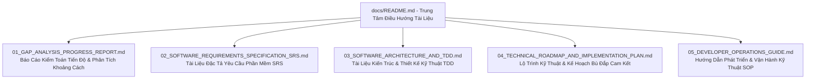

# HỆ THỐNG TÀI LIỆU KỸ THUẬT PHẦN MỀM — HIỆU ĐÀN ĐỨC NGÂN
> **Phiên bản:** 3.1 | **Cập nhật:** Tháng 9/2026  
> **Nền tảng:** Next.js 16.3.1 (App Router) + React 19.2.8 + Tailwind CSS v4 + TypeScript 5  
> **Mục đích:** Trung tâm điều hướng và lưu trữ toàn bộ hồ sơ kỹ thuật, đặc tả yêu cầu, kiểm toán tiến độ cam kết và hướng dẫn vận hành của dự án phần mềm Hiệu Đàn Đức Ngân.

---

## 1. MỤC LỤC BỘ TÀI LIỆU KỸ THUẬT CHÍNH THỨC

Hệ thống tài liệu kỹ thuật phần mềm của dự án được tổ chức thành 5 văn kiện cốt lõi, phục vụ cho quá trình phát triển, kiểm toán cam kết và vận hành bàn giao:

### Chi tiết các văn kiện:

1. **[01. Báo Cáo Kiểm Toán Tiến Độ & Phân Tích Khoảng Cách Cam Kết (Gap Analysis)](./01_GAP_ANALYSIS_PROGRESS_REPORT.md)**
   - Bảng đối chiếu chi tiết giữa hiện trạng mã nguồn thực tế và 12 hạng mục tính năng cốt lõi trong Bản báo giá MESP.
   - Định lượng tỷ lệ hoàn thành thực tế: **~51.2%** (Frontend UI đạt ~85%, Logic & CMS đạt ~15%).
   - Danh mục cụ thể các tính năng kỹ thuật còn thiếu cần bổ sung.
   - Đánh giá rủi ro kỹ thuật và khuyến nghị giải pháp bù đắp.

2. **[02. Tài Liệu Đặc Tả Yêu Cầu Phần Mềm (Software Requirements Specification — SRS)](./02_SOFTWARE_REQUIREMENTS_SPECIFICATION_SRS.md)**
   - Soạn thảo theo cấu trúc tiêu chuẩn quốc tế ISO/IEC/IEEE 29148:2018.
   - Đặc tả 10 yêu cầu chức năng (FR-01 đến FR-10): Quản lý hiển thị Hero Glide, Danh mục ToneLab, Hồ sơ chi tiết sản phẩm, Dải nghe âm sắc, Giỏ hàng & VietQR Napas, Form đánh giá 1-5 sao kèm upload ảnh, Banner nổi khuyến mãi, Đa ngôn ngữ song ngữ Anh - Việt, Hệ thống CMS.
   - Đặc tả 5 yêu cầu phi chức năng (NFR-01 đến NFR-05): Hiệu năng Core Web Vitals (LCP < 2s, CLS = 0), Responsive đa thiết bị, Bảo mật HTTP Headers, Kỹ thuật SEO JSON-LD.
   - Ma trận truy vết yêu cầu (Traceability Matrix).

3. **[03. Tài Liệu Kiến Trúc & Thiết Kế Kỹ Thuật (Technical Design Document — TDD)](./03_SOFTWARE_ARCHITECTURE_AND_TDD.md)**
   - Sơ đồ kiến trúc phân tầng (Presentation, Domain, Data, Integration).
   - Bản đồ cấu trúc thư mục và ranh giới thành phần mã nguồn.
   - Hợp đồng mô hình dữ liệu (Type Contracts): Product, CustomerReview, Order, Instrument, Chapter.
   - Cơ chế tương tác vật lý đơn nhất (Physical In-Place Glide) và Khóa cuộn nền Lenis Scroll an toàn Hydration.
   - Phân tích và đề xuất giải pháp tích hợp Hệ thống quản trị nội dung CMS (Decap CMS vs Embedded Next.js Admin vs Cloud Headless).

4. **[04. Lộ Trình Kỹ Thuật & Kế Hoạch Thực Thi Bù Đắp Cam Kết (Technical Roadmap)](./04_TECHNICAL_ROADMAP_AND_IMPLEMENTATION_PLAN.md)**
   - Phân kỳ triển khai 5 giai đoạn để hoàn thành 100% cam kết kỹ thuật:
     - *Phase 1:* Bù đắp trang pháp lý (`/privacy`, `/terms`), Banner nổi khuyến mãi, Thanh liên hệ nổi đa kênh (Hotline, Zalo, Facebook).
     - *Phase 2:* Tích hợp Đa ngôn ngữ i18n (VI/EN) & Công cụ Google (GA4, GTM, GSC, YouTube embed).
     - *Phase 3:* Phát triển Module Form góp ý & Đánh giá trải nghiệm 1-5 sao có kiểm duyệt.
     - *Phase 4:* Tích hợp Hệ thống Quản trị Nội dung CMS chuyên nghiệp.
     - *Phase 5:* Cấu hình 301 Redirects trong `next.config.ts` & Kiểm thử nghiệm thu kỹ thuật.

5. **[05. Hướng Dẫn Phát Triển & Vận Hành Kỹ Thuật (Developer & Operations Guide)](./05_DEVELOPER_OPERATIONS_GUIDE.md)**
   - Yêu cầu môi trường (Node.js 20+, pnpm 11.21.0).
   - Hướng dẫn cài đặt, chạy dev server Turbopack, kiểm tra linter và đóng gói sản phẩm.
   - Quy chuẩn hệ thống 2 phông chữ (Cormorant Garamond + Inter) và bảng màu gỗ óc chó nghệ nhân.
   - Nguyên tắc phòng ngừa lỗi Hydration với `useSyncExternalStore` và tối ưu hình ảnh Next.js.
   - Hướng dẫn triển khai lên Vercel và Máy chủ VPS Linux Nginx / PM2.
   - Bảng kiểm tra nghiệm thu kỹ thuật bàn giao (Acceptance Checklist).

---

## 2. NGUYÊN TẮC QUẢN TRỊ TÀI LIỆU (DOCUMENTATION GOVERNANCE)

- **Định hướng kỹ thuật thuần túy:** Toàn bộ tài liệu chỉ tập trung vào kiến trúc mã nguồn, nghiệp vụ phần mềm, logic tương tác và bằng chứng thực thi thực tế. Loại bỏ hoàn toàn các yếu tố giá thành thương mại hoặc tiếp thị quảng bá.
- **Tính chính xác & Đồng bộ:** Mỗi khi có sự thay đổi về cấu trúc route, thêm module hoặc sửa đổi hợp đồng dữ liệu trong `src/`, tệp tài liệu tương ứng tại thư mục `docs/` bắt buộc phải được cập nhật đồng thời trong cùng một commit.
